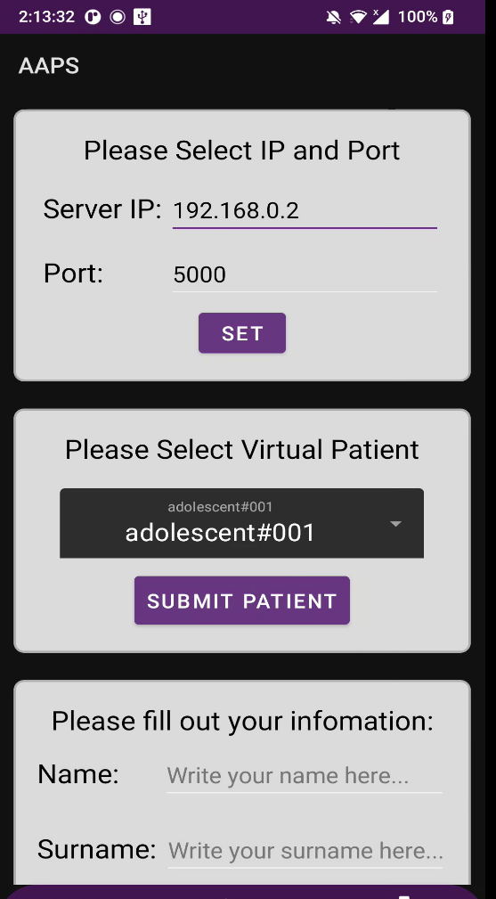
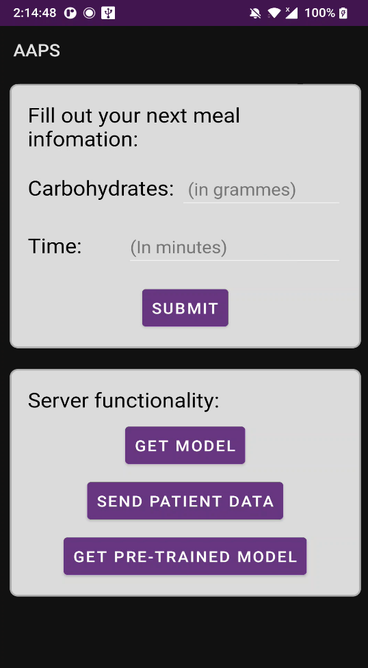
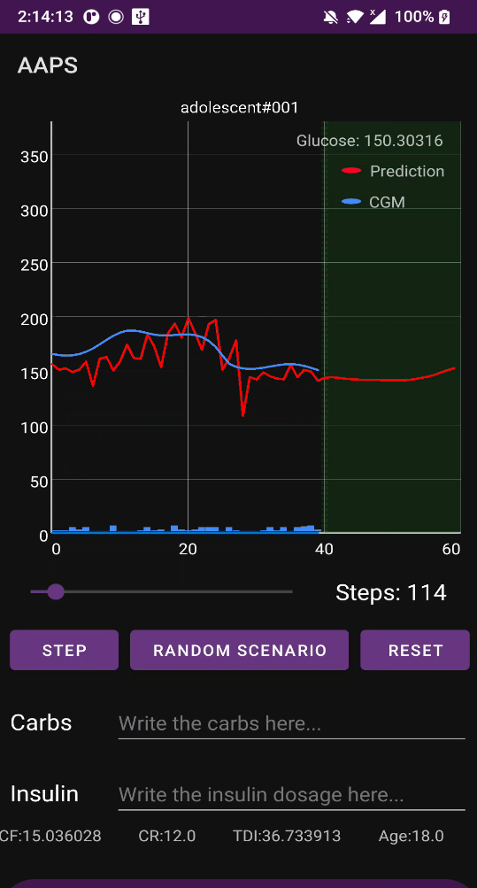
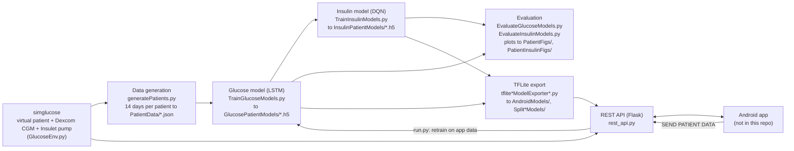

# t1d-glucose-insulin-nn

Neural networks for glucose forecasting and insulin dosing, built on a simulator of virtual type 1 diabetes patients.

> **Medical disclaimer.** This is a research and education project. It was trained and evaluated only on
> *simulated* patients, it is not a medical device, and it must not be used to make or inform decisions about
> real insulin dosing or any other treatment. Do not connect it to a real pump or a real person's CGM data.

> **Name.** Despite the "AAPS" label inside the Android screenshots, this project has nothing to do with
> [AndroidAPS](https://github.com/nightscout/AndroidAPS) (the open-source artificial pancreas system). The
> repository was previously called `AAPS`.

## What it is

The project wraps the [simglucose](https://github.com/jxx123/simglucose) simulator (UVA/Padova virtual patients,
Dexcom CGM sensor and Insulet pump models) in a small environment, uses it to generate multi-day glucose, meal and
insulin traces, and trains two kinds of models per virtual patient: an LSTM that forecasts the next hour of CGM
readings, and a recurrent Q-network (DQN) that picks an insulin dose from that forecast. The trained models are
converted to TensorFlow Lite for on-device use and served, together with the simulator, by a Flask REST API to an
Android app that shows the CGM trace next to the model prediction. It started as a final-year thesis project for a
Computer Engineering degree.

  

*Android client screenshots: server and virtual patient selection (left), meal entry and server functions
(middle), CGM trace in blue with the model's prediction in red (right). The Android app itself is not part of this
repository.*

## Pipeline



**Simulator (`GlucoseEnv.py`).** `GlucoseEnvironment` creates a simglucose patient with a Dexcom sensor and an
Insulet pump and a clock-seeded random meal scenario. `reset(patient_name)` starts a new run and `step(basal,
extra_carbs)` advances one 3-minute CGM sample and returns the CGM value. Patient parameters (age, carb ratio,
correction factor, total daily insulin, body weight) are read from simglucose. 30 virtual patients are available
(`adolescent#001`-`#010`, `adult#001`-`#010`, `child#001`-`#010`).

**Data generation (`generatePatientData.py`, `generatePatients.py`).** Runs a patient for a number of days (14 in the
committed data, 6720 samples each) while a controller built from the pre-trained base models in `OrginalModels/`
chooses the insulin, with a rule-based fallback (correction dose plus carb dose) when the predicted glucose would drop
below 80 mg/dL. It writes `time`, `glucose`, `action` (insulin) and `meal` series to `PatientData/`.

**Glucose model (`machineLearn4.py`).** Input is the last 20 samples (one hour) of `[time of day, CGM, carbs,
insulin]`, min-max scaled with `scalar20-20-age-3layers-256-time`, plus the patient's scaled age. Three stacked LSTM
layers (256, 256, 128 units) feed a dense layer that outputs the next 20 CGM samples (one hour ahead). Loss is MSE
with Adam. Per-patient models start from the base weights in `OrginalModels/`.

**Insulin model (`TrainInsulinModels.py`).** A Q-network over 20 discrete insulin doses. Its inputs are the last 20
`[CGM, carbs, insulin]` samples and the glucose model's 20-sample forecast; three LSTM layers are initialised from the
patient's glucose model and frozen; a front LSTM with a small dense adapter, a GRU(64) and the output layer with one
Q-value per dose are trained. Training is
standard DQN with a replay buffer, epsilon-greedy exploration, a target network and Huber loss, against an
environment (`gym_glucose/envs/GlucoseEnv.py`) whose reward is +1 for CGM in 90-140 mg/dL, +0.1 for 70-90 or
140-180, negative above 180 or below 70, and -1 below 30 or above 300. Doses range up to 0.08 (0.04 for children)
in simglucose pump units.

**Export and serving.** The exporters split each model into two TFLite files (the recurrent part, and the final dense
layer that takes the age or the forecast) so the Android app can feed it the extra input. `rest_api.py` exposes the
simulator (`/reset`, `/step`, `/get_params`, `/get_age`, `/get_cgm_hist`, `/get_cho_hist`, `/get_insulin_hist`,
`/get_time_hist`), accepts patient data from the phone (`/get_past_data`) and serves the TFLite models
(`/get_model/<name>`, `/pre_trained_glucose_get_model/<patient>/<part>`,
`/pre_trained_insulin_get_model/<patient>/<part>`).

## Results

These numbers are read off the plots committed in the repository (`PatientFigs/`, `PatientInsulinFigs/`), which are
written by the evaluation scripts. I have not re-generated them; each plot is a single simulation run with a
clock-seeded random meal scenario, so a re-run will give different values.

**Glucose forecast error** (`EvaluateGlucoseModels.py`, one simulated week per patient). RMSE compares the CGM trace
with the forecasts averaged per time step (each point is the mean of the up to 20 overlapping forecasts that cover
it), so it is not a pure 60-minute-ahead error.

| Patient | RMSE (mg/dL) | Patient | RMSE (mg/dL) | Patient | RMSE (mg/dL) |
|---|---|---|---|---|---|
| adolescent#001 | 9.66 | adult#001 | 11.88 | child#002 | 11.00 |
| adolescent#002 | 13.88 | adult#002 | 10.40 | child#006 | 13.07 |
| adolescent#007 | 20.90 | adult#009 | 14.12 | child#008 | 38.89 |

Median over the nine patients: 13.07 mg/dL; best 9.66 (adolescent#001), worst 38.89 (child#008). In these plots the
patient glucose often runs into the sensor floor of 39 mg/dL or reaches 400-600 mg/dL, because the evaluation drives
the simulator with a fixed insulin model, so the series are far more extreme than a well-controlled patient.

**Insulin policy** (`EvaluateInsulinModels.py`, per-patient DQN with the safety fallback). TIR is the share of samples
at 60-180 mg/dL, TBR below 60, TAR above 180 (definitions as in the script, which uses 60 rather than the usual
70 mg/dL for the low threshold). Run length differs between the plots.

| Patient | TIR | TBR | TAR | Forecast RMSE (mg/dL) |
|---|---|---|---|---|
| adolescent#001 | 87.50% | 0.00% | 12.50% | 7.98 |
| adolescent#002 | 34.58% | 14.17% | 51.25% | 16.97 |
| adolescent#007 | 51.88% | 12.92% | 35.21% | 12.45 |
| adult#001 | 47.65% | 6.70% | 45.65% | 11.18 |
| adult#002 | 71.25% | 0.00% | 28.75% | 8.63 |
| adult#009 | 27.44% | 25.21% | 47.35% | 12.67 |
| child#002 | 69.38% | 14.35% | 16.28% | 18.69 |

The policy is clearly not good enough for anything beyond a demonstration: time below range reaches 25% for
adult#009 and exceeds 12% for four of the seven patients, and no result is compared against a baseline controller
such as simglucose's basal-bolus controller. Models are evaluated on a fresh simulated run of the same virtual
patient they were trained on, not on held-out patients.

## Repository layout

| Path | Contents |
|---|---|
| `GlucoseEnv.py`, `gym_glucose/` | Simulator wrapper (no TensorFlow needed); Gym environment used for DQN training |
| `machineLearn4.py` | `LSTMModel`: glucose model, scaling, windowing, insulin-model builder |
| `generatePatients.py`, `generatePatientData.py` | Synthetic data generation |
| `TrainGlucoseModels.py`, `TrainInsulinModels.py`, `run.py` | Training (`run.py` retrains on data uploaded from the app) |
| `EvaluateGlucoseModels.py`, `EvaluateInsulinModels.py` | Evaluation and plots |
| `tflite*ModelExporter*.py` | Keras weights to TFLite |
| `rest_api.py` | Flask API for the Android app |
| `tests/`, `pytest.ini`, `.github/workflows/ci.yml` | Smoke tests and CI |
| `PatientData/` | Generated traces (`<patient>_Dexcom_Insulet_patientData.json`) and `patient_data.json`, an example upload from the app |
| `OrginalModels/` | Base glucose and insulin weights that the per-patient models start from (folder name kept as is) |
| `GlucosePatientModels/`, `InsulinPatientModels/` | Per-patient Keras weights (`.h5`); the insulin folder also holds the target networks |
| `AndroidModels/`, `OlderModels/` | Latest and older generic TFLite exports (`GlucoseModel1/2`, `InsulinModel1/2`) |
| `SplitGlucoseModels/`, `SplitInsulinModels/` | Per-patient TFLite parts served by the API, plus the intermediate SavedModel folders they were converted from |
| `PatientFigs/`, `PatientInsulinFigs/` | Evaluation plots |
| `scalar20-20-age-3layers-256-time` | Pickled scikit-learn `MinMaxScaler` for the four input features |

The model and data files are committed on purpose because the scripts and the API load them from these paths, which
is why the repository is about 200 MB.

## Setup

Python 3.10 is what the project was verified with.

```bash
git clone https://github.com/ChRotsides/t1d-glucose-insulin-nn.git
cd t1d-glucose-insulin-nn
python -m venv .venv
source .venv/bin/activate          # Windows: .venv\Scripts\activate
pip install -r requirements.txt
```

`requirements.txt` pins TensorFlow 2.11.0 with NumPy 1.23.5 (TensorFlow 2.11 does not work with NumPy 2.x),
simglucose 0.2.3 and gym 0.9.4. All scripts expect to be run from the repository root.

## Usage

**Tests** (about 20 seconds):

```bash
pip install -r requirements-dev.txt
pytest
```

**Generate patient data.** Edit `options` in `generatePatients.py` (and the `days` argument), then
`python generatePatients.py`. Output goes to `PatientData/<patient>_Dexcom_Insulet_patientData.json`.

**Train a glucose model.** Set `patient_name` and `epochs` in `TrainGlucoseModels.py` and run it. It loads
`GlucosePatientModels/Patient_<patient>_Dexcom_Insulet_patientDataweights20-20-age-3layers-256-time.h5` as the starting
point; for a patient that has no weights yet, point `load_weights` at
`OrginalModels/weights20-20-age-3layers-256-time.h5` first. The result is written back to `GlucosePatientModels/`.

**Train an insulin model.** Edit the `patients` list in `TrainInsulinModels.py` (the patient needs a glucose model) and
run it. It trains until the running reward exceeds 1000 and saves weights to `InsulinPatientModels/` after every
episode.

**Evaluate.** Edit `patients` at the top of `EvaluateGlucoseModels.py` or `EvaluateInsulinModels.py` and run it. Each
runs seven simulated days per patient and saves a plot to `PatientFigs/` or `PatientInsulinFigs/`, overwriting the
committed one for that patient.

**Export to TFLite.** `python tfliteGlucoseModelExporter_pretrained.py adult#002` and
`python tfliteInsulinModelExporter_pretrained.py adult#002` write the two-part models to `SplitGlucoseModels/` and
`SplitInsulinModels/`. The non-`_pretrained` exporters take a weights path and write `AndroidModels/`.

**Serve the Android app.** `python rest_api.py [HOST] [PORT]` (default `127.0.0.1 5000`; use your machine's LAN
address for a phone on the same network). In the app, enter the server IP and port, choose a virtual patient, then
use GET PRE-TRAINED MODEL to download its models. The API has no authentication, so run it only on a trusted network.

**Retrain on data from the app.** Press SEND PATIENT DATA in the app (the API stores it as
`PatientData/patient_data.json`), then run `python run.py <file name without .json> <epochs>`, for example
`python run.py patient_data 5`. This fine-tunes the glucose and insulin models and exports the new TFLite files to
`AndroidModels/`; GET MODEL in the app downloads them. Note that `run.py` currently starts from the
`adolescent#001` weights regardless of the patient in the file.

## Tech stack

Python, TensorFlow/Keras (LSTM, GRU, DQN written by hand), TensorFlow Lite, simglucose, Gym, NumPy, pandas,
scikit-learn, Matplotlib, Flask, pytest, ruff, GitHub Actions. The Android client is a separate app.

## Tests and CI

`tests/` has smoke tests for the simulator wrapper (reset/step, carbs raise glucose, insulin lowers it, risk index),
the committed data files, the REST API (via the Flask test client) and the models (base weights load and predict,
the insulin network has 20 outputs, the four TFLite files run with the expected shapes). The GitHub Actions workflow
runs `ruff check --select E9,F63,F7,F82`, the TensorFlow-free tests, and the TensorFlow tests as a second job. Training
and the exporters are not covered by tests.

## Limitations and known issues

- Virtual patients only. Nothing here was validated on real CGM, insulin or meal data, and the simulator's
  physiology is itself a model.
- The glucose models are trained per virtual patient and evaluated on new runs of the same patient; generalisation
  to unseen patients is not measured.
- Results are single runs with random meals, no confidence intervals, no baseline controller, and a few plots (for
  example child#006 and child#008) show unstable behaviour.
- In the generated data the time input is `int(timestamp_ms) % 86400`, which is a 12-sample sawtooth rather than a
  time of day (the Gym environment uses seconds modulo 86400). It is left as is because the committed scaler and
  weights were trained with it.
- The training and evaluation scripts use hard-coded patient lists and paths that you edit in the source rather than
  command-line options, and the evaluation scripts run the whole loop on import.
- The scaler is a pickle; only load pickles you trust.
- Training, the exporters and the REST retraining path were not re-run as part of the recent clean-up; the evaluation
  loop was smoke-tested for a short run and the test suite passes (see above).

## Credits and licenses

- **simglucose** by Jinyu Xie, MIT licence: the virtual patients, CGM sensor and pump models, and the basis of the
  environment step loop and the `risk_index` function (see `THIRD_PARTY_NOTICES.md`).
- TensorFlow/Keras, NumPy, pandas, SciPy, scikit-learn, Matplotlib, Flask and Gym are used as libraries under their
  own licenses.
- Thesis team: Antreana Christoforidi, Charalambos Rotsides, Constantinos Palochis, Maria Ashikali and Theofanis
  Lymbouris.

## License

Free for noncommercial and research use under the [PolyForm Noncommercial License 1.0.0](LICENSE). Commercial use
requires a separate license: contact lhampis@gmail.com.

Copyright 2023-2026 Charalambos Rotsides. Third-party components keep their own licenses.
